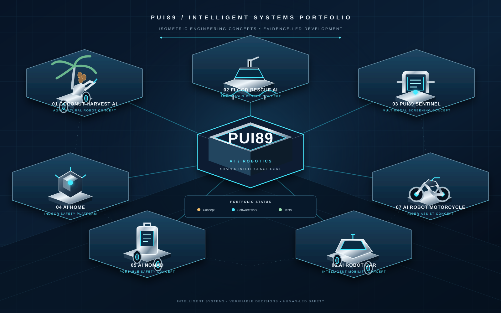

# PUI89 — Intelligent Systems & AI Engineering

**Intelligent Systems. Verifiable Decisions. Safer Outcomes.**

PUI89 is an independent AI engineering initiative developing practical AI software, shared engineering foundations, and robotics-system concepts. The work spans agriculture, disaster response, multimodal inspection, home environments, mobile assistance, and intelligent mobility.

PUI89 follows one central principle: **make system behaviour, evidence, uncertainty, limitations, and safety boundaries inspectable.** Project concepts, implemented software, automated test results, simulations, and validated real-world capabilities are described separately.

  

  <a href="https://pui89.github.io/">English website</a> ·
  <a href="https://pui89.github.io/th.html">เว็บไซต์ภาษาไทย</a> ·
  <a href="https://github.com/Pui89">GitHub portfolio</a>

---

## What PUI89 is building

PUI89 develops seven independent project lines supported by a shared AI engineering direction:

- **Shared AI Core:** reusable contracts, evidence handling, uncertainty-aware state, safety gates, verification utilities, and project adapters.
- **Domain-specific AI software:** perception, monitoring, decision-support, and task-planning workflows tailored to each project.
- **Robotics and mobility concepts:** software-first designs that progress through requirements, synthetic tests, simulation, supervised integration, and validation.
- **Compute intelligence:** software research into matching AI workloads with CPU, GPU, NPU/AI accelerators, DSPs, microcontrollers, memory, and power constraints.

The compute direction is **software integration and coordination**, not semiconductor chip manufacturing. No hardware performance, energy saving, or cost reduction is claimed without measured evidence.

## Seven-project portfolio

Each project has its own repository, requirements, risks, and validation gates. Shared interfaces are reused through documented boundaries; project-specific safety and domain logic remain separate.

| Project | Focus | Repository | Website |
|---|---|---|---|
| **Coconut Harvest AI** | Coconut maturity assessment and a proposed robotic harvesting workflow | [Repository](https://github.com/Pui89/Coconut-Harvest-AI) | [EN](https://pui89.github.io/coconut.html) · [TH](https://pui89.github.io/coconut-th.html) |
| **Extreme Flood Rescue AI** | Flood awareness and human-supervised rescue-support concepts | [Repository](https://github.com/Pui89/Extreme-Flood-Rescue-AI) | [EN](https://pui89.github.io/flood-rescue.html) · [TH](https://pui89.github.io/flood-rescue-th.html) |
| **PUI89 Sentinel** | Multimodal screening and inspection support with authorised human review | [Repository](https://github.com/Pui89/Multimodal-Narcotics-Screening-AI) | [EN](https://pui89.github.io/screening.html) · [TH](https://pui89.github.io/screening-th.html) |
| **PUI89 AI HOME** | Indoor home-condition awareness and evidence-led assistance | [Repository](https://github.com/Pui89/AI-Home-Safety-Robot) | [EN](https://pui89.github.io/home.html) · [TH](https://pui89.github.io/home-th.html) |
| **PUI89 AI NOMAD** | Compact, owner-supervised mobile assistant concept | [Repository](https://github.com/Pui89/AI-Mobile-Assistant-Robot) | [EN](https://pui89.github.io/nomad.html) · [TH](https://pui89.github.io/nomad-th.html) |
| **PUI89 AI Robot Car** | Software-first vehicle intelligence and driver-support research | [Repository](https://github.com/Pui89/AI-Autonomous-Robot-Car) | [EN](https://pui89.github.io/ai-robot-car.html) · [TH](https://pui89.github.io/ai-robot-car-th.html) |
| **PUI89 EasyRide AI Motorcycle** | Rider-centred mobility intelligence and road-awareness research | [Repository](https://github.com/Pui89/AI-Motorcycle-Robotics) | [EN](https://pui89.github.io/ai-robot-motorcycle.html) · [TH](https://pui89.github.io/ai-robot-motorcycle-th.html) |

**Project maturity:** these are independent development tracks. Some contain implemented software and automated tests; others remain at requirements, architecture, or concept stages. A concept image is not evidence of a built robot. Each repository and project page must state its current evidence and limitations.

## Shared AI Core

The Shared AI Core is the common engineering foundation intended to reduce duplicated infrastructure while preserving project-specific requirements.

### Core contracts

Versioned machine-readable contracts define:

- `Observation` — a sourced, timestamped input with quality and uncertainty information.
- `WorldState` — a structured view of what is currently known, unknown, stale, or conflicting.
- `ActionProposal` — a bounded, reviewable recommendation; a proposal is not permission to execute.
- `FailureReport` — structured information about errors, blocked operations, and missing evidence.
- `Evidence Passport` — provenance, supporting and conflicting evidence, uncertainty, review, and verification records.

### Implemented engineering areas

- **Network Intelligence v0.1:** validates user-declared network inventory and renders static topology diagrams. It does not scan, discover, monitor, or configure live networks.
- **Compute Intelligence v0.1:** evaluates caller-declared workload and processor profiles and produces proposal-only recommendations. It does not probe hardware, execute workloads, or schedule processes.
- **Compute Benchmark v0.2:** validates and compares supplied benchmark records while separating measured, synthetic, and estimated evidence. Synthetic examples are not hardware measurements.
- **Contract and safety checks:** dependency-light automated checks for supported data structures and fail-closed behaviour.

The Shared AI Core is being integrated incrementally. The presence of a shared contract or module does not mean every project has a completed runtime adapter.

**Shared AI Core overview:** [English](https://pui89.github.io/ai-core.html) · [ภาษาไทย](https://pui89.github.io/ai-core-th.html)

## Engineering method

PUI89 uses a staged workflow:

1. **Define** the problem, intended users, operating context, and measurable requirements.
2. **Specify** data contracts, system boundaries, hazards, privacy requirements, and acceptance criteria.
3. **Implement** small, reviewable software components with explicit dependencies and cost limits.
4. **Test** deterministic behaviour, invalid inputs, missing data, stale evidence, conflicts, and failure paths.
5. **Simulate** only where the simulator, assumptions, and limitations are documented.
6. **Review** evidence, security, licensing, resource use, and human-approval requirements.
7. **Validate** against the intended real-world operating envelope before making performance or safety claims.

### Evidence maturity vocabulary

Use these labels consistently across READMEs, website pages, reports, and releases:

| Label | Meaning |
|---|---|
| **Proposed** | A concept, requirement, or planned capability; not implemented. |
| **Specified** | Scope, interface, and acceptance method are documented. |
| **Implemented** | Code or a defined control exists in the repository. |
| **Tested** | A named test or workflow ran successfully under stated conditions. |
| **Simulated** | A documented scenario was executed in a simulator or synthetic environment. |
| **Validated** | Appropriate domain-specific evidence supports the stated use and operating limits. |
| **Certified** | An applicable certification has been issued by an authorised body. |
| **Unknown / Not tested** | Evidence is absent, incomplete, or not yet checked. |

A passing software test does not prove model accuracy, sensor calibration, simulator fidelity, physical safety, water or fire resistance, regulatory compliance, or commercial readiness.

## Safety, privacy, and security

- Keep consequential decisions under appropriate human authority.
- Treat missing, stale, malformed, low-quality, or conflicting evidence conservatively.
- Separate observations, world-state estimates, proposals, approvals, and physical actions.
- Do not expose passwords, API keys, tokens, private network details, private sensor recordings, or personal data in public repositories.
- Use least privilege and review GitHub Actions, dependencies, model files, datasets, and external services before adoption.
- Require explicit human approval for destructive, security-sensitive, or physical operations.
- Do not treat a policy document or a configured workflow as proof that a control is effective; retain test and audit evidence.

## Open-source-first and zero-cost development

PUI89 prioritises open-source tools, transparent licences, reproducible workflows, and local/offline methods where practical.

- No paid API, subscription, hosted inference, cloud GPU, or recurring service is adopted without explicit approval.
- No package, model weight, dataset, firmware, or large dependency is downloaded automatically.
- Check licence terms, provenance, privacy, security, hardware requirements, and maintenance before adoption.
- Public availability does not automatically grant permission for reuse or commercial deployment.
- Cost and resource assumptions must be stated; do not claim savings without measured evidence.

## Collaboration

PUI89 welcomes responsible discussions with researchers, universities, engineers, domain specialists, data stewards, public-interest organisations, and potential strategic partners.

Useful collaboration begins with a clearly scoped problem, access to appropriate domain expertise or lawful data, measurable outcomes, and an agreed evidence and safety plan. A discussion does not imply a signed partnership, grant award, product availability, or validated capability.

- **Portfolio and project information:** [pui89.github.io](https://pui89.github.io/)
- **Initiative profile:** [English](https://pui89.github.io/company.html) · [ภาษาไทย](https://pui89.github.io/company-th.html)
- **Open-source resources:** [English](https://pui89.github.io/open-source-resources.html) · [ภาษาไทย](https://pui89.github.io/open-source-resources-th.html)
- **Evidence and progress:** [English](https://pui89.github.io/evidence.html) · [ภาษาไทย](https://pui89.github.io/evidence-th.html)
- **GitHub:** [github.com/Pui89](https://github.com/Pui89)
- **Contact:** puinuanmanee@gmail.com

---

*Public project information is maintained on a best-effort basis. For current implementation and test status, consult the relevant repository, commit, workflow run, and project-specific evidence record. Website descriptions are summaries and do not replace technical documentation.*
