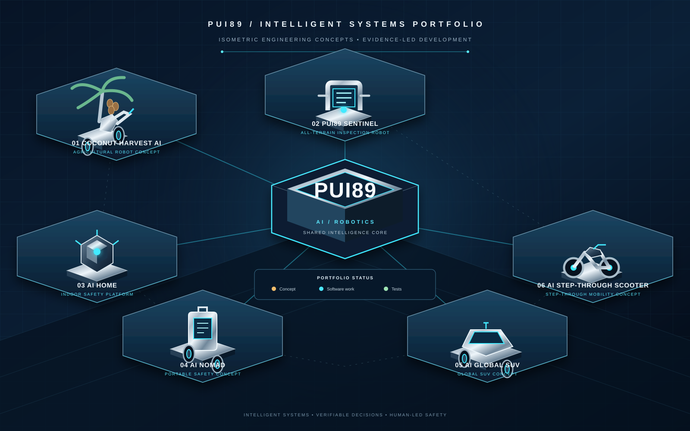

# PUI89 — Independent Industrial AI Initiative

[English](README.md) · [ภาษาไทย](README.th.md)

**Founder-led. Independently developed in Thailand. Built progressively for the real world.**

PUI89 is an independent, software-first Industrial AI initiative led by its founder. Independence does not mean working alone: PUI89 welcomes companies, hardware manufacturers, relevant startups and experienced professionals who can contribute expertise, technology, hardware, resources and practical support to help turn product concepts into real-world solutions. The founder retains strategic direction and leadership. Multiple product concepts share one PUI89 identity and are developed progressively according to evidence, resources and priorities—not all at once. The intended core team remains deliberately small, with one founder and up to one or two specialist collaborators when justified.

PUI89 is open to partnerships and collaboration with technology companies, hardware manufacturers, relevant startups and experienced professionals. It welcomes suitable hardware support, including equipment, components, technical resources and access to platforms for evaluation. Partnerships may be project-specific or ongoing, with clear scope and agreed responsibilities.

PUI89 follows one central principle: **make system behaviour, evidence, uncertainty, limitations, and safety boundaries inspectable.** Project concepts, implemented software, automated test results, simulations, and validated real-world capabilities are described separately.

## Product philosophy

> **Build what you wish existed as a user.**
>
> สร้างสิ่งที่คุณอยากให้มีในฐานะผู้ใช้งาน

Start with what people genuinely wish they had and would value using. Understand real needs, design the user experience, and engineer practical value—not merely what is technically possible. Apply this philosophy across all six products. The developer's perspective is a starting point, not a substitute for real user needs, feedback, usability testing, or evidence.

  

  <a href="https://pui89.github.io/">English website</a> ·
  <a href="https://pui89.github.io/th.html">เว็บไซต์ภาษาไทย</a> ·
  <a href="https://github.com/Pui89">GitHub portfolio</a>

---

## Six-Product Capability Architecture — 18 November 2026

The bilingual product pages now describe each product's sensory perception, understanding, prediction, decision support, physical interaction, reliability and evidence boundaries. The shared homepage overview explains the common intelligence lifecycle. The [PUI89 Shared AI Core](https://github.com/Pui89/PUI89-Shared-AI-Core) owns the reusable architecture; product-specific capabilities and validation remain in each project repository.

## Product operating coverage standard

The bilingual [PUI89 Product Operating Coverage Standard v1.0](docs/PUI89_PRODUCT_OPERATING_COVERAGE_STANDARD_V1.0.md) defines the correct per-unit allocation and measurement method for all six active products. It sets AI HOME at one robot and one charging dock per floor; defines Coconut Harvest AI by assigned plantation work, Sentinel by inspection mission/site zone, AI NOMAD by traveller/luggage task, and each vehicle AI system by one vehicle and its approved routes. Unsupported numerical coverage figures are explicitly withdrawn; public capacity claims require product-specific test evidence. The standard is a proposed requirement, not proof of physical performance.

## Portfolio documentation alignment

The authoritative six-product scope, Sentinel's general multimodal quadruped identity, evidence-label rules and bilingual website review checklist are recorded in [PUI89 Portfolio Alignment Register](docs/PUI89_PORTFOLIO_ALIGNMENT_REGISTER_2026-11-18.md). This is a governance record, not a claim that every product capability is implemented or validated.

## Global manufacturing handoff system

PUI89 now maintains a common [Global Manufacturing Handoff System v1.0](docs/PUI89_GLOBAL_MANUFACTURING_HANDOFF_SYSTEM_V1.0.md) across all six active product repositories. It defines exact component/BOM data, material and process controls, interfaces, work instructions, inspection and test evidence, approved substitutions, TQ/NCR/ECR workflows, factory qualification and release authority. It is designed so qualified teams can work from controlled records without relying on undocumented founder explanations. Unknown values remain **TBD / NOT RELEASED** and must never be guessed.

## What PUI89 is building

PUI89 develops six active product projects supported by a shared AI engineering direction:

- **Shared AI Core:** reusable contracts, evidence handling, uncertainty-aware state, safety gates, verification utilities, and project adapters.
- **Domain-specific AI software:** perception, monitoring, decision-support, and task-planning workflows tailored to each project.
- **Robotics and mobility concepts:** software-first designs that progress through requirements, synthetic tests, simulation, supervised integration, and validation.
- **Compute intelligence:** software research into matching AI workloads with CPU, GPU, NPU/AI accelerators, DSPs, microcontrollers, memory, and power constraints.

The compute direction is **software integration and coordination**, not semiconductor chip manufacturing. No hardware performance, energy saving, or cost reduction is claimed without measured evidence.

## Six-product portfolio

Each project has its own repository, requirements, risks, and validation gates. Shared interfaces are reused through documented boundaries; project-specific safety and domain logic remain separate.

| Project | Focus | Repository | Website |
|---|---|---|---|
| **Coconut Harvest AI** | Coconut maturity assessment and a proposed robotic harvesting workflow | [Repository](https://github.com/Pui89/Coconut-Harvest-AI) | [EN](https://pui89.github.io/coconut.html) · [TH](https://pui89.github.io/coconut-th.html) |
| **PUI89 Sentinel — All-Terrain Exploration & Inspection Robot** | PUI89 Sentinel: four-legged quadruped robot dog concept for supervised industrial, infrastructure and outdoor inspection | [Repository](https://github.com/Pui89/PUI89-All-Terrain-Inspection-Robot) | [EN](https://pui89.github.io/sentinel.html) · [TH](https://pui89.github.io/sentinel-th.html) |
| **PUI89 AI HOME** | Indoor home-condition awareness and evidence-led assistance | [Repository](https://github.com/Pui89/AI-Home-Safety-Robot) | [EN](https://pui89.github.io/home.html) · [TH](https://pui89.github.io/home-th.html) |
| **PUI89 AI NOMAD — Carry-on Suitcase-Style Mobile AI Assistant** | Upright carry-on luggage form, telescopic pull handle and four spinner caster wheels at the base; 8–10 kg target, 10 kg maximum; not airline-certified or physically validated | [Repository](https://github.com/Pui89/AI-Mobile-Assistant-Robot) | [EN](https://pui89.github.io/nomad.html) · [TH](https://pui89.github.io/nomad-th.html) |
| **PUI89 AI Global SUV** | Medium-size global SUV concept; HEV-first evaluation with powertrain-neutral AI software | [Repository](https://github.com/Pui89/PUI89-AI-Global-SUV) | [EN](https://pui89.github.io/ai-global-suv.html) · [TH](https://pui89.github.io/ai-global-suv-th.html) |
| **PUI89 AI Step-Through Scooter** | Rider-centred mobility intelligence and road-awareness research | [Repository](https://github.com/Pui89/AI-Step-Through-Scooter) | [EN](https://pui89.github.io/ai-robot-motorcycle.html) · [TH](https://pui89.github.io/ai-robot-motorcycle-th.html) |

**Project maturity:** these are independent development tracks. Some contain implemented software and automated tests; others remain at requirements, architecture, or concept stages. A concept image is not evidence of a built robot. Each repository and project page must state its current evidence and limitations.

### PUI89 AI Global SUV — flagship mobility concept

The PUI89 AI Global SUV is a proposed medium-size, five-door SUV design study. Its current styling direction uses Deep Navy, restrained Electric Cyan lighting and Titanium Silver details. Full Hybrid (HEV) is the first powertrain architecture proposed for evaluation; no production drivetrain has been selected.

**AI concept:** authorised observations → input-quality and provenance checks → Shared AI Core `WorldState` → hazard analysis → safety gate → human-facing advisory. The system is intended to remain advisory-only. The driver retains control; the current software-stage scope has no steering, throttle, braking, propulsion, ECU/CAN or battery-management command path.

**Research areas:** road-scene awareness, weather and route context, road-condition awareness, explainable driver advisories, and future read-only vehicle-health awareness where authorised interfaces exist. Missing, stale, conflicting or insufficient evidence must be visible; uncertain conditions must not be presented as safe.

**Evidence boundary:** this is an early software foundation and design concept. It does not establish a physical SUV prototype, validated perception model, road test, selected supplier, production specification, vehicle certification, autonomous-driving capability, vehicle operating limits, fuel economy, range or performance result.

**Project pages:** [English](https://pui89.github.io/ai-global-suv.html) · [ภาษาไทย](https://pui89.github.io/ai-global-suv-th.html) · [AI Vehicles overview](https://pui89.github.io/ai-vehicles.html).

## Shared AI Core

The Shared AI Core is the common engineering foundation intended to reduce duplicated infrastructure while preserving project-specific requirements.

### Core contracts

Versioned machine-readable contracts define:

- `Observation` — a sourced, timestamped input with quality and uncertainty information.
- `WorldState` — a structured view of what is currently known, unknown, stale, or conflicting.
- `ActionProposal` — a bounded, reviewable recommendation; a proposal is not permission to execute.
- `FailureReport` — structured information about errors, blocked operations, and missing evidence.
- `Evidence Passport` — provenance, supporting and conflicting evidence, uncertainty, review, and verification records.

### Implemented engineering areas

- **Network Intelligence v0.1:** validates user-declared network inventory and renders static topology diagrams. It does not scan, discover, monitor, or configure live networks.
- **Compute Intelligence v0.1:** evaluates caller-declared workload and processor profiles and produces proposal-only recommendations. It does not probe hardware, execute workloads, or schedule processes.
- **Compute Benchmark v0.2:** validates and compares supplied benchmark records while separating measured, synthetic, and estimated evidence. Synthetic examples are not hardware measurements.
- **Contract and safety checks:** dependency-light automated checks for supported data structures and fail-closed behaviour.

The Shared AI Core is being integrated incrementally. The presence of a shared contract or module does not mean every project has a completed runtime adapter.

**Shared AI Core overview:** [English](https://pui89.github.io/ai-core.html) · [ภาษาไทย](https://pui89.github.io/ai-core-th.html)

**Tactile Intelligence architecture (proposed):** [PUI89 Tactile Intelligence Architecture v0.1](docs/PUI89_TACTILE_INTELLIGENCE_ARCHITECTURE_V0.1.md) — a hardware-neutral design for touch, contact, pressure, force, slip, vibration and haptic interaction across applicable products. This is a specification, not evidence of a built or validated tactile system.

**Coconut Harvest Physical AI architecture (proposed):** [Coconut Harvest AI Physical AI Architecture v0.1](docs/COCONUT_HARVEST_PHYSICAL_AI_ARCHITECTURE_V0.1.md) — founder-selected separate ground-mobility/tree-climbing configurations and arm-first harvesting research, with open-source-first tools, model governance, simulation gates and safety boundaries. This is a design specification, not a physical prototype claim.\n\n**Coconut arm and gripper simulation specification (proposed):** [Simulation Specification v0.1](docs/COCONUT_ARM_GRIPPER_SIMULATION_SPEC_V0.1.md) — defines the fixed-base arm/gripper test boundary, grasp state machine, synthetic tactile signals, fault scenarios, evidence logs and validation gates. No simulator or hardware is claimed to have been run or built.

**Flood Resilience Engineering v0.1 (proposed):** [Architecture](docs/PUI89_FLOOD_RESILIENCE_ARCHITECTURE_V0.1.md) and [Test & Validation Plan](docs/PUI89_FLOOD_RESILIENCE_TEST_AND_VALIDATION_V0.1.md) — define shared flood-awareness, conservative risk assessment, system-health response and a controlled 20 cm test programme. A dependency-light Python reference module and synthetic unit tests are included under `shared_ai_core/environmental_resilience/` and `tests/environmental_resilience/`. The 20 cm figure is a proposed controlled test target, not a validated product capability or flood-crossing recommendation. Physical protection, IP ratings and product operation remain untested.

**Structural & Environmental Intelligence v0.1 (proposed):** [Architecture](docs/PUI89_STRUCTURAL_ENVIRONMENTAL_INTELLIGENCE_V0.1.md) and a dependency-light reference rules module under `shared_ai_core/structural_environmental/`, with tests under `tests/structural_environmental/`. Scope includes object/building vibration indicators, shaking-event awareness, human-reviewed crack-change tracking, humidity monitoring, and conservative sensor-health handling. Thresholds are site- and asset-specific; this is not earthquake prediction, a building-safety diagnosis, or a validated monitoring installation.

## Engineering method

PUI89 uses a staged workflow:

1. **Define** the problem, intended users, operating context, and measurable requirements.
2. **Specify** data contracts, system boundaries, hazards, privacy requirements, and acceptance criteria.
3. **Implement** small, reviewable software components with explicit dependencies and cost limits.
4. **Test** deterministic behaviour, invalid inputs, missing data, stale evidence, conflicts, and failure paths.
5. **Simulate** only where the simulator, assumptions, and limitations are documented.
6. **Review** evidence, security, licensing, resource use, and human-approval requirements.
7. **Validate** against the intended real-world operating envelope before making performance or safety claims.

### Evidence maturity vocabulary

Use these labels consistently across READMEs, website pages, reports, and releases:

| Label | Meaning |
|---|---|
| **Proposed** | A concept, requirement, or planned capability; not implemented. |
| **Specified** | Scope, interface, and acceptance method are documented. |
| **Implemented** | Code or a defined control exists in the repository. |
| **Tested** | A named test or workflow ran successfully under stated conditions. |
| **Simulated** | A documented scenario was executed in a simulator or synthetic environment. |
| **Validated** | Appropriate domain-specific evidence supports the stated use and operating limits. |
| **Certified** | An applicable certification has been issued by an authorised body. |
| **Unknown / Not tested** | Evidence is absent, incomplete, or not yet checked. |

A passing software test does not prove model accuracy, sensor calibration, simulator fidelity, physical safety, water or fire resistance, regulatory compliance, or commercial readiness.

## PUI89 AI 2030 Vision

**From intelligent software to evidence-led Physical AI products.** The bilingual [AI 2030 Vision (English)](https://pui89.github.io/ai-2030.html) · [วิสัยทัศน์ AI 2030 (ภาษาไทย)](https://pui89.github.io/ai-2030-th.html) sets out how PUI89 connects governed AI-agent workflows, Perception & Task Intelligence (PTI), the Shared AI Core, heterogeneous edge computing, simulation, safety and evidence across the six-product portfolio. It is a strategic roadmap, not a claim that future agents, robots, vehicle systems or product capabilities are already implemented or validated.

## Safety, privacy, and security

- Keep consequential decisions under appropriate human authority.
- Treat missing, stale, malformed, low-quality, or conflicting evidence conservatively.
- Separate observations, world-state estimates, proposals, approvals, and physical actions.
- Do not expose passwords, API keys, tokens, private network details, private sensor recordings, or personal data in public repositories.
- Use least privilege and review GitHub Actions, dependencies, model files, datasets, and external services before adoption.
- Require explicit human approval for destructive, security-sensitive, or physical operations.
- Do not treat a policy document or a configured workflow as proof that a control is effective; retain test and audit evidence.

## Open-source-first technology governance

PUI89 prioritises open-source tools, transparent licences, reproducible workflows, and local/offline methods where practical.

- No paid API, subscription, hosted inference, cloud GPU, or recurring service is adopted without explicit approval.
- No package, model weight, dataset, firmware, or large dependency is downloaded automatically.
- Check licence terms, provenance, privacy, security, hardware requirements, and maintenance before adoption.
- Public availability does not automatically grant permission for reuse or commercial deployment.
- Cost and resource assumptions must be stated; do not claim savings without measured evidence.

## Open partnerships and collaboration

PUI89 is currently developed by one founder. The intended core team is deliberately small: one founder and, only when a specific product or engineering need justifies it, one or two specialist collaborators.

PUI89 welcomes partnership and collaboration proposals from technology companies, hardware manufacturers, relevant startups, and experienced AI developers, software engineers, embedded/electronics engineers, robotics specialists and product engineers.

Potential collaboration may include compatible hardware evaluation, software–hardware integration, specialist technical advice, focused engineering contributions and controlled testing. Hardware providers may propose bringing their own compatible equipment for evaluation, subject to technical suitability, available capacity, resources, safety and mutually agreed written conditions.

PUI89 welcomes partnerships that create practical value. They may be project-specific or ongoing, depending on mutual interests, technical fit, available capacity and clearly agreed goals. Each proposal is considered individually. Before work begins, the parties should agree in writing on scope, responsibilities, costs, equipment ownership, intellectual property, licences, confidentiality, data rights, safety and publication permissions. An enquiry or discussion does not establish a partnership, endorsement, sponsorship or employment relationship. Organisation names and logos are used only with appropriate permission.

- **Portfolio and project information:** [pui89.github.io](https://pui89.github.io/)
- **Technical collaboration:** [English](https://pui89.github.io/support.html) · [ภาษาไทย](https://pui89.github.io/support-th.html)
- **Evidence and progress:** [English](https://pui89.github.io/evidence.html) · [ภาษาไทย](https://pui89.github.io/evidence-th.html)
- **GitHub:** [github.com/Pui89](https://github.com/Pui89)
- **Contact:** puinuanmanee@gmail.com

## Active portfolio — authoritative scope

PUI89 has **exactly six active products**. [PUI89 Portfolio Source of Truth v1.0](PUI89_PORTFOLIO_SOURCE_OF_TRUTH_V1.0.md) is the canonical record for all six product names, repository links, bilingual website links, founder-approved requirements and evidence maturity labels. Shared AI Core is common infrastructure, not a seventh product. Flood and road-water awareness may remain advisory requirements within relevant mobility products; they are not a separate product.

The source of truth also records the HOME 8 kg target / 10 kg maximum, NOMAD's ground-use four-wheel mobile-assistant identity, Sentinel's mission-before-hardware gate, and the Coconut rights → human labels → held-out CPU evaluation sequence.

---

## Easy to Build. Easy to Repair. Built to Grow.

PUI89's engineering principle for this product is to start with the simplest useful configuration, make modules understandable and serviceable, and allow verified capabilities to grow without redesigning the entire system.

- **Easy to Build:** prefer simple, documented and available components; separate essential functions from optional upgrades.
- **Easy to Repair:** use accessible replaceable modules, labelled connections, diagnostics and documented service/recovery procedures.
- **Built to Grow:** use versioned interfaces and adapters so compatible sensors, compute and software modules can be added without breaking verified functions.
- **Graceful degradation:** identify missing, stale or failed modules, explain the lost capability and enter the product-specific safe state when a critical function is affected.
- **Product-specific engineering:** reuse shared software and proven interfaces where appropriate, but do not force identical hardware, mechanics, power or safety designs across different products.

**Shared design standard:** [PUI89 Build, Repair & Grow Design Principle v1.0](https://github.com/Pui89/Pui89.github.io/blob/main/docs/PUI89_BUILD_REPAIR_GROW_DESIGN_PRINCIPLE_V1.0.md). This is a design requirement, not a claim that modular hardware, repair procedures or product capabilities have already been implemented or validated.

### ภาษาไทย

**สร้างง่าย ซ่อมง่าย และต่อยอดได้** — เริ่มจากระบบที่เล็กที่สุดซึ่งพิสูจน์ประโยชน์ได้จริง ใช้โมดูลที่เข้าใจและเปลี่ยนได้ง่าย มีจุดเชื่อมต่อและขั้นตอนซ่อมบำรุงชัดเจน และเพิ่มความสามารถโดยไม่ต้องออกแบบระบบทั้งหมดใหม่ ต้องแจ้งเมื่ออุปกรณ์ขาดหายหรือขัดข้อง และเข้าสู่สถานะปลอดภัยเฉพาะผลิตภัณฑ์เมื่อกระทบฟังก์ชันสำคัญ สามารถใช้ซอฟต์แวร์หรือส่วนเชื่อมต่อร่วมกันได้เมื่อผ่านการตรวจสอบ แต่ไม่บังคับให้ทุกผลิตภัณฑ์ใช้ฮาร์ดแวร์ กลไก พลังงาน หรือระบบความปลอดภัยแบบเดียวกัน

**มาตรฐานกลาง:** [PUI89 Build, Repair & Grow Design Principle v1.0](https://github.com/Pui89/Pui89.github.io/blob/main/docs/PUI89_BUILD_REPAIR_GROW_DESIGN_PRINCIPLE_V1.0.md). เป็นข้อกำหนดการออกแบบ ไม่ใช่การยืนยันว่าฮาร์ดแวร์แบบโมดูล ขั้นตอนซ่อม หรือความสามารถของผลิตภัณฑ์ได้พัฒนาและตรวจสอบแล้ว

## Offline Independence & Connectivity Resilience

**The Product Must Work Without the App. Safety Must Work Without Connectivity.** PUI89's proposed mandatory requirements for all six products cover physical/local controls, offline operation, product-specific safe states, local records and recovery, printed manuals, optional remote access, failure-injection tests and evidence-based release gates.

- [PUI89 Offline Independence & Connectivity Resilience Standard v1.0](docs/PUI89_OFFLINE_INDEPENDENCE_CONNECTIVITY_RESILIENCE_STANDARD_V1.0.md)
- Every product must document what works at fully offline, local-connection, internet-connected and remote-service levels. The app and QR code are optional; neither replaces printed safety instructions or local controls.
- This is an engineering standard and development requirement, not evidence that products are implemented, tested, certified or validated.

## Evidence-Based Engineering & Product Readiness

PUI89's public engineering policy is **No Evidence, No Readiness Claim**. The controlled maturity sequence is Proposed → Specified → Implemented → Tested → Validated → Product-Ready. Each public claim must show its scope, evidence status, verified conditions, limitations, and next gate. A successful build, test suite, simulation, or demo alone does not establish validation or product readiness.

- [English standard](https://github.com/Pui89/PUI89-Shared-AI-Core/blob/main/docs/standards/PUI89_EVIDENCE_BASED_ENGINEERING_PRODUCT_READINESS_STANDARD_V1.0.md)
- [มาตรฐานภาษาไทย](https://github.com/Pui89/PUI89-Shared-AI-Core/blob/main/docs/standards/PUI89_EVIDENCE_BASED_ENGINEERING_PRODUCT_READINESS_STANDARD_V1.0.th.md)
- [Website: Engineering Standards](https://pui89.github.io/engineering-standards.html) · [ภาษาไทย](https://pui89.github.io/engineering-standards-th.html)

The standard is proposed for portfolio-wide adoption. Product maturity must be assessed separately using product-specific evidence; no Product-Ready claim is implied by publishing the standard.

## Global Engineering & Manufacturing

The bilingual [Global Engineering & Manufacturing portal](https://pui89.github.io/global-engineering.html) provides the six-product manufacturing overview. The [Global Engineering & Manufacturing Standard v1.0](docs/PUI89_GLOBAL_ENGINEERING_MANUFACTURING_STANDARD_V1.0.md) defines documentation levels, SI units, materials/component provenance, extreme-climate qualification, manufacturing transfer, quality gates and evidence labels. Product-specific preliminary briefs are linked from the portal. All candidate specifications remain distinct from released production specifications and verified capabilities.

## Portfolio status review — 24 November 2026

PUI89's active portfolio contains **six products**. Shared AI Core is platform infrastructure, not a seventh product. Extreme Flood Rescue AI is retired and is not part of the active portfolio. Flood and road-water observations may remain conservative advisory requirements inside relevant mobility products; they do not create a separate rescue product. Historical narcotics-screening work is outside Sentinel's current scope.

| Active product | Current maturity | Next evidence gate |
|---|---|---|
| Coconut Harvest AI | Implemented — software and evaluation-preparation foundation | Rights-cleared real images, human-reviewed labels, leakage-safe split and reproducible CPU evaluation with per-class metrics. |
| PUI89 Sentinel | Specified — supervised quadruped inspection requirements | Select one authorised inspection mission; define site, hazards, operating envelope and measurable acceptance criteria. |
| PUI89 AI HOME | Implemented — early requirements, architecture and software foundations | Software-only home-awareness demonstrator with traceable observations and repeatable tests; no live sensor or robot claim. |
| PUI89 AI NOMAD | Implemented — early software foundation | Validate the suitcase user journey, dimensions, handling, wheel/handle ergonomics, mass and power budgets. |
| PUI89 AI Global SUV | Implemented — software-only safety and contract foundation | Establish the hazard/use-case baseline and reproducible advisory-only scenario evaluation; driver control remains authoritative. |
| PUI89 AI Step-Through Scooter | Specified — rider-first product requirements | Complete rider hazard analysis, measurable acceptance criteria and reproducible advisory-software test evidence. |

These maturity labels describe documented development state, not commercial readiness. They do not establish physical prototypes, integrated hardware, field validation, certification or production capability. A concept image, simulation or passing software test is not physical-performance evidence. Do not publish readiness percentages without a current, traceable evidence register.

**Latest dated product evidence:** Coconut Harvest AI's 24 November update records dataset split-isolation checks, public image-source research and a blank field-discovery register. It does not establish an approved training dataset, completed human annotation, a trained/evaluated PUI89 model, accuracy metrics or a working harvesting robot.

**Review date:** 24 November 2026. Recheck each product repository and the bilingual [Evidence & Progress pages](https://pui89.github.io/evidence.html) before making a newer maturity claim.
